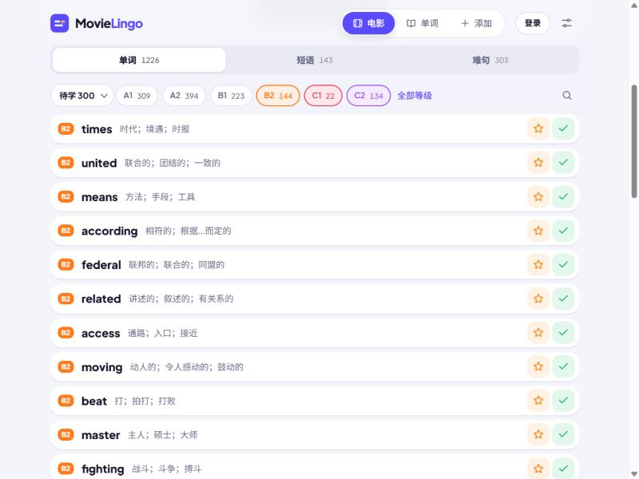
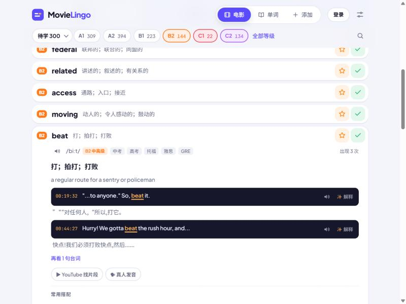
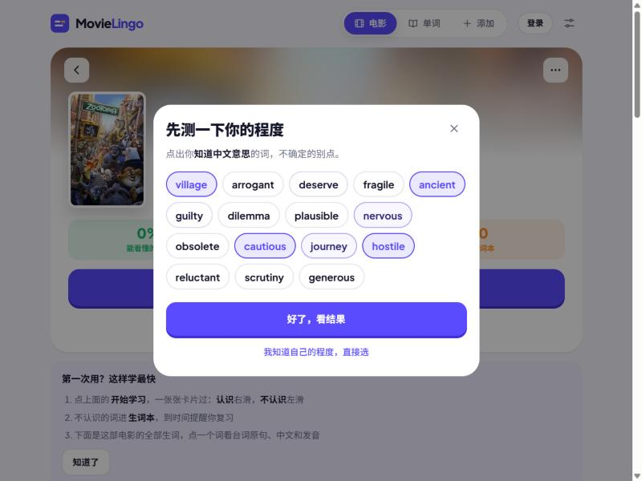
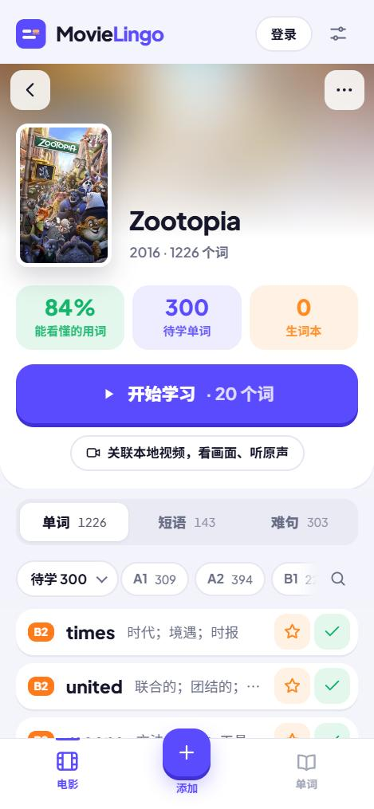
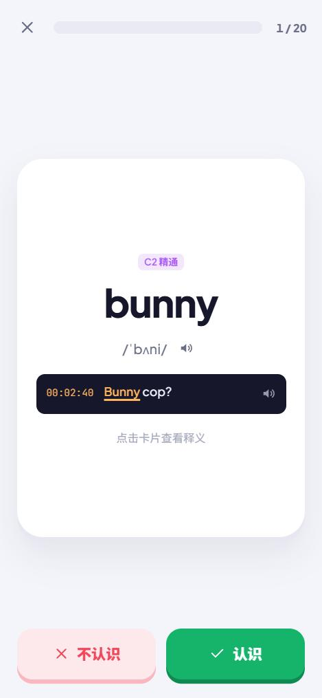

# MovieLingo 🎬

**Learn the English words of a movie before you watch it.**
看电影之前，先学会里面的单词。

**Live:** [movie-lingo.com](https://movie-lingo.com)

## What it does

Pick a movie. MovieLingo downloads its English subtitles, pulls out every word and phrase, and turns them into a study list
graded by CEFR level (A1–C2), each with the real line from the film, a timestamp, pronunciation and a Chinese meaning.

- **Level test in 30 seconds**: tap the words you know; words below your level are hidden so you only see what is new to you.
- **Comprehension score**: shows how much of the film you can already follow and how it grows as you learn.
- **Flashcards with the film's own lines**: swipe right for 认识, left for 不认识; the film's most repeated unknown words come first.
- **Spaced repetition**: saved words come back after 1 / 3 / 7 / 14 / 30 days as cloze, meaning and listening quizzes.
- **Phrases and hard lines**: about 3,200 multi-word expressions (figure it out, make up one's mind) detected across tenses and split verbs.
- **Your own video**: link a local video file and each word plays its scene (nothing is uploaded).
- **Works on any device**: installable web app (PWA) with offline mode, Google sign-in and cloud sync.

| Word list by level | Word details with film lines |
|---|---|
|  |  |

| Level test | Phone: movie page | Phone: flashcards |
|---|---|---|
|  |  |  |

## How it is built

| Part | Technology |
|---|---|
| Web app | One self-contained HTML/CSS/JavaScript page, PWA with a service worker |
| Word analysis | Python build step: NLTK and WordNet for lemmas and parts of speech, CEFR levels, ECDICT for Chinese meanings and IPA |
| API | Cloudflare Workers: movie search (TMDB), subtitle download (SubDL), AI explanations, translation, payments |
| Accounts and data | Supabase (Postgres with row-level security, Google OAuth) |
| Hosting | Cloudflare (custom domain), earlier GitHub Pages |
| Payments | Touch 'n Go DuitNow QR, matched automatically to orders |

This repository holds the published web app. The analysis scripts, API and database code are kept private.

## Status

Live since October 2026, built for Malaysian Chinese students preparing for SPM, IELTS and other English exams.
First film free; membership RM19.90 / 30 days or RM49.90 lifetime.

---

This product uses the TMDB API but is not endorsed or certified by TMDB.
Movie posters and subtitles belong to their owners.
